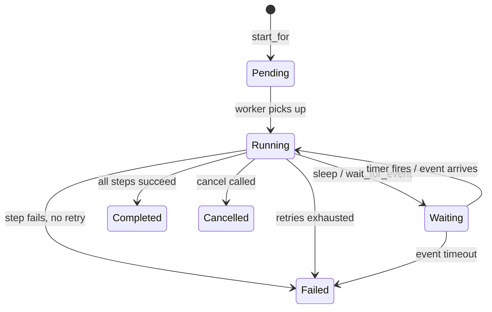

import { Aside, Tabs, TabItem } from '@astrojs/starlight/components';

## What Is Durable Execution?

Durable execution lets you write long-running workflows as ordinary async Rust code. Each step is checkpointed to the database. If your process crashes, times out, or gets redeployed, Zart resumes from the last successful step — no work is lost, no step is repeated.

Think of it like GitHub Actions: your workflow has multiple steps, and if the infrastructure fails mid-run, it resumes where it left off. No one configures durability as a non-functional requirement — it's just how the platform works. Zart brings that same default-reliable experience to your Rust backend.

```
Step 1: send_email    ──✓── persisted
Step 2: charge_card   ──💥── crash here
Step 3: send_receipt
─────────────────────────────
Restart → Step 1 is SKIPPED (cached)
        → Step 2 is SKIPPED (cached)
        → Step 3 runs → done
```

## How to Trigger a Workflow

Every durable execution is identified by a **unique execution ID** that doubles as an idempotency key. Calling `start_for` with the same ID twice is safe — the second call returns `ExecutionAlreadyExists` so you can wait on the existing execution instead of creating a duplicate.

<Tabs syncKey="sdk">
<TabItem label="Rust">

```rust
use zart::prelude::*;

let durable = DurableScheduler::from_backend(&pg);

// Schedule a new execution (idempotent)
durable
    .start_for::<OnboardingTask>("signup-user-42", "onboarding", &OnboardingData {
        email: "alice@example.com".into(),
    })
    .await?;
```

</TabItem>
<TabItem label="Python">

```python
import zart

scheduler = zart.DurableScheduler(backend)

# Schedule a new execution (idempotent)
await scheduler.start(
    "signup-user-42",
    "onboarding",
    {"email": "alice@example.com"},
)
```

</TabItem>
<TabItem label="TypeScript">

```ts
import { Effect, Schema } from "effect";
import { DurableScheduler, PgBackend } from "@zart/effect";

const OnboardingData = Schema.Struct({ email: Schema.String });

const program = Effect.scoped(
  Effect.gen(function* () {
    const backend = yield* PgBackend.scoped(process.env.DATABASE_URL!);
    const scheduler = yield* DurableScheduler.fromBackend(backend);

    // Schedule a new execution (idempotent)
    yield* scheduler.start("signup-user-42", "onboarding", OnboardingData, {
      email: "alice@example.com",
    });
  }),
);
```

</TabItem>
</Tabs>

You trigger executions from anywhere — a web handler, a CLI command, a background job. The scheduler and the worker share the same PostgreSQL backend, so they can run in the same process or on separate machines.

## How to Wait for Results

### `wait_completion<T>` — block and deserialize

The simplest way to wait for a result. Blocks until the execution finishes, then deserializes the output to `T`.

<Tabs syncKey="sdk">
<TabItem label="Rust">

```rust
let output: OnboardingOutput = durable
    .wait_completion("signup-user-42", Duration::from_secs(60), None)
    .await?;

println!("Done: {:?}", output);
```

</TabItem>
<TabItem label="Python">

```python
raw = await scheduler.wait_completion("signup-user-42", timeout_secs=60.0)
output = zart.from_json_value(raw, OnboardingOutput)
print(f"Done: {output}")
```

</TabItem>
<TabItem label="TypeScript">

```ts
const OnboardingOutput = Schema.Struct({ ok: Schema.Boolean });

const output = yield* scheduler.waitCompletion("signup-user-42", OnboardingOutput, 60);
console.log("Done:", output);
```

</TabItem>
</Tabs>

If the execution doesn't finish within the timeout, `wait_completion` returns `WaitTimedOut`. Deserialization errors are surfaced as `SchedulerError::Deserialization`.

### `start_and_wait_for<H>` — start and wait in one call

For the common case where you start an execution and immediately wait, use `start_and_wait_for`. It infers input and output types from the handler type:

<Tabs syncKey="sdk">
<TabItem label="Rust">

```rust
let output = durable
    .start_and_wait_for::<OnboardingTask>(
        "signup-user-42",
        "onboarding",
        &OnboardingData { email: "alice@example.com".into() },
        Duration::from_secs(60),
    )
    .await?;
// output: OnboardingOutput — inferred from OnboardingTask::Output
```

</TabItem>
<TabItem label="Python">

```python
await scheduler.start("signup-user-42", "onboarding", {"email": "alice@example.com"})
raw = await scheduler.wait_completion("signup-user-42", timeout_secs=60.0)
output = zart.from_json_value(raw, OnboardingOutput)
```

</TabItem>
<TabItem label="TypeScript">

```ts
yield* scheduler.start("signup-user-42", "onboarding", OnboardingData, {
  email: "alice@example.com",
});
const output = yield* scheduler.waitCompletion("signup-user-42", OnboardingOutput, 60);
```

</TabItem>
</Tabs>

### `wait_for<H>` — wait with handler-inferred types

When you started an execution earlier and now want the typed result without manual deserialization:

<Tabs syncKey="sdk">
<TabItem label="Rust">

```rust
let output = durable
    .wait_for::<OnboardingTask>("signup-user-42", Duration::from_secs(60))
    .await?;
// output: OnboardingOutput — inferred from OnboardingTask::Output
```

</TabItem>
<TabItem label="Python">

```python
raw = await scheduler.wait_completion("signup-user-42", timeout_secs=60.0)
output = zart.from_json_value(raw, OnboardingOutput)
```

</TabItem>
<TabItem label="TypeScript">

```ts
const output = yield* scheduler.waitCompletion("signup-user-42", OnboardingOutput, 60);
```

</TabItem>
</Tabs>

### `status` — check without blocking

<Tabs syncKey="sdk">
<TabItem label="Rust">

```rust
let record = durable.status("signup-user-42").await?;
println!("Status: {:?}", record.status);
// ExecutionStatus::Scheduled | Running | Completed | Failed | Cancelled
```

</TabItem>
<TabItem label="Python">

```python
record = await scheduler.status("signup-user-42")
print(f"Status: {record.status}")
```

</TabItem>
<TabItem label="TypeScript">

```ts
const record = yield* scheduler.status("signup-user-42");
console.log("Status:", record.status);
```

</TabItem>
</Tabs>

### `cancel` — stop a running execution

<Tabs syncKey="sdk">
<TabItem label="Rust">

```rust
let cancelled = durable.cancel("signup-user-42").await?;
```

</TabItem>
<TabItem label="Python">

```python
cancelled = await scheduler.cancel("signup-user-42")
```

</TabItem>
<TabItem label="TypeScript">

```ts
const cancelled = yield* scheduler.cancel("signup-user-42");
```

</TabItem>
</Tabs>

A cancelled execution stops at its next scheduling point. Steps currently running will finish, but no new steps will be scheduled.

## The Lifecycle



1. **Schedule** — `start_for` inserts a row in `zart_executions` with status `scheduled`.
2. **Claim** — Workers poll PostgreSQL with `SELECT … FOR UPDATE SKIP LOCKED`. Exactly one worker owns one execution.
3. **Run** — The handler body executes. Each step call checks the database:
   - **Hit** — stored result deserialized and returned; the step logic is never called again.
   - **Miss** — the step runs, the result is persisted, then returned.
4. **Complete** — the handler returns `Ok`; status becomes `completed` and the output is stored.
5. **Fail** — the handler returns `Err`; after retries are exhausted, status becomes `failed`.

## Idempotency Guarantee

The execution ID is your idempotency key. If the same user signs up twice due to a double-click, the second `start_for` call returns `ExecutionAlreadyExists` — you detect this and simply wait on the existing execution.

<Tabs syncKey="sdk">
<TabItem label="Rust">

```rust
match durable.start_for::<OnboardingTask>(&exec_id, "onboarding", &input).await {
    Ok(_) => println!("New execution started"),
    Err(SchedulerError::ExecutionAlreadyExists(_, _)) => {
        println!("Already running, waiting on existing…");
    }
    Err(e) => return Err(e.into()),
}

// In all cases, wait on the execution and get typed output
let output: OnboardingOutput = durable
    .wait_completion(&exec_id, Duration::from_secs(60), None)
    .await?;
```

</TabItem>
<TabItem label="Python">

```python
try:
    await scheduler.start(exec_id, "onboarding", zart.to_json_value(input_data))
    print("New execution started")
except zart.ZartError:
    print("Already running, waiting on existing…")

# In all cases, wait on the execution and get typed output
raw = await scheduler.wait_completion(exec_id, timeout_secs=60.0)
output = zart.from_json_value(raw, OnboardingOutput)
```

</TabItem>
<TabItem label="TypeScript">

```ts
yield* scheduler
  .start(execId, "onboarding", OnboardingData, input)
  .pipe(
    Effect.catch((e) =>
      e._tag === "ExecutionAlreadyExists"
        ? Effect.log("Already running, waiting on existing…")
        : Effect.fail(e),
    ),
  );

// In all cases, wait on the execution and get typed output
const output = yield* scheduler.waitCompletion(execId, OnboardingOutput, 60);
```

</TabItem>
</Tabs>

## Next Steps

- [**Steps**](/docs/concepts/steps/) — define and compose durable work
- [**Flow Control**](/docs/concepts/flow-control/) — parallel steps, sleeps, and events
- [**Error Handling**](/docs/concepts/error-handling/) — the three-way outcome model
