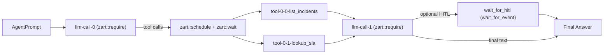
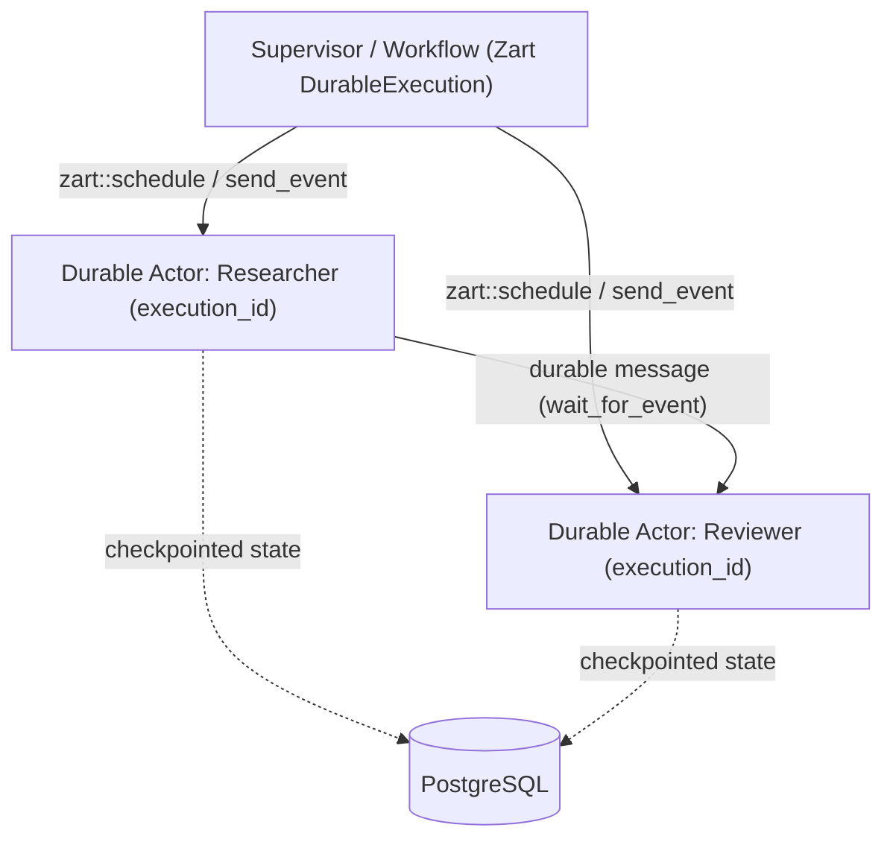

import { Aside } from '@astrojs/starlight/components';

`zart-autoagents` is the official Zart integration crate for [AutoAgents](https://github.com/liquidos-ai/AutoAgents), bringing crash-proof, PostgreSQL-backed durable execution to Rust AI agents.

Instead of treating an entire agent run as a single opaque step, `zart-autoagents` persists **every turn of the ReAct loop** — each LLM call, each tool execution (including parallel fan-out), and any human-in-the-loop wait — as deterministic Zart steps.

## Why intra-loop durability?

Long-running agents make expensive LLM calls, invoke external APIs, and wait for human approvals. Without intra-loop checkpointing, a worker crash on turn 4 forces the agent to replay turns 1–3 from scratch — re-paying for tokens and re-running side-effecting tools.

With `zart-autoagents`:
- **LLM calls are cached (`llm-call-{turn}`):** Completed model responses are serialized with `DurableChatResponse` and replayed directly from PostgreSQL on restart.
- **Parallel tool calls stay parallel (`tool-{turn}-{idx}-{name}`):** When the model emits multiple tool calls in one turn, `DurableReactTask` fans them out concurrently using `zart::schedule` and joins them via `zart::wait`.
- **Human-in-the-loop suspends with zero CPU:** `wait_for_hitl` wraps `zart::wait_for_event`, suspending the agent until an external approval signal arrives.



---

## Core Building Blocks

| Type / Function | Purpose |
| :--- | :--- |
| `DurableReactTask<A>` | Implements `DurableExecution` to drive an AutoAgents `ReActAgent` loop directly on Zart primitives (`zart::require`, `zart::schedule`, `zart::wait`). |
| `AgentPrompt` | Serializable input wrapper (`{ prompt: String }`) passed when starting a `DurableReactTask`. |
| `DurableLLMProvider` | Transparent `LLMProvider` wrapper that checkpoints `chat` and `chat_with_tools` calls inside Zart steps. |
| `DurableChatResponse` | Serde-serializable representation of LLM text, thinking/reasoning, tool calls, and token usage. |
| `DurableTool` | Wraps an AutoAgents `ToolT` so individual tool invocations execute inside durable Zart steps. |
| `DurableAgent<T>` | Wraps an `AgentExecutor` together with `ControlFlowSlot` for custom agent loops. |
| `ControlFlowSlot` & `run_durable_agent` | Bridges AutoAgents' `Result<_, E>` boundaries with Zart's `StepError::Scheduled` suspension signal. |
| `wait_for_hitl` | Durable human-in-the-loop helper backed by `zart::wait_for_event`. |

---

## Quick Start with `DurableReactTask`

Add `zart-autoagents` to your `Cargo.toml` alongside `zart` and `autoagents`:

```toml
[dependencies]
zart = "0.2.2"
zart-autoagents = { path = "../../crates/zart-autoagents" }
autoagents = "0.4"
```

Define your AutoAgents tools and `#[agent(...)]` struct as usual, then register `DurableReactTask::new(agent, llm)` with Zart's `WorkerBuilder`:

```rust
use std::sync::Arc;
use std::time::Duration;
use zart::PgBackend;
use zart::prelude::*;
use zart_autoagents::{AgentPrompt, DurableReactTask};

let durable = DurableScheduler::from_backend(&pg);
let input = AgentPrompt::new(
    "Investigate recent incidents on 'checkout-api', check customer SLA, and summarize."
);

durable
    .start_for::<DurableReactTask<IncidentAgent>>(
        &execution_id,
        "durable-incident-agent",
        &input,
    )
    .await?;

let worker = Arc::new(
    zart::WorkerBuilder::from_backend(&pg)
        .register_durable_task(
            "durable-incident-agent",
            DurableReactTask::new(IncidentAgent {}, llm),
        )
        .build(),
);
```

When the model decides to call multiple tools in the same turn (for example, fetching logs for `INC-101` and `INC-102` simultaneously), `DurableReactTask` schedules each tool as an independent Zart child step and awaits all of them via `zart::wait`. If the worker restarts mid-turn, completed tool steps are replayed from PostgreSQL and only pending steps run.

<Aside type="tip">
  See the complete runnable SRE incident investigation example in `examples/autoagents-durable`, including `thoughtSignature` preservation for Gemini 3 tool-calling turns.
</Aside>

---

## Human-in-the-Loop (`wait_for_hitl`)

To pause an agent workflow until a human approves or provides input, call `wait_for_hitl`:

```rust
use serde::Deserialize;
use std::time::Duration;
use zart_autoagents::wait_for_hitl;

#[derive(Deserialize)]
struct Approval {
    approved: bool,
    reviewer: String,
}

let decision: Approval = wait_for_hitl(
    "manager-approval",
    Some(Duration::from_secs(86_400)),
).await?;
```

While waiting, the execution occupies zero worker threads. Delivering the `"manager-approval"` event via `DurableScheduler::send_event` or the HTTP Admin API resumes the agent right after the wait point.

---

## Roadmap: Full AutoAgents Compatibility & Durable Actors

`DurableReactTask` covers single-agent ReAct loops today. Our goal for `zart-autoagents` is **full compatibility with the AutoAgents ecosystem**, specifically bringing Zart's durability guarantees to **AutoAgents Actors**:



Planned milestones toward full AutoAgents parity:

1. **Durable `ActorAgent` Runtime:** Map AutoAgents actors (`AgentActor` / `ActorAgent`) to long-lived Zart durable executions addressable by `execution_id`, preserving actor state across worker restarts and deploys.
2. **Durable Actor Mailboxes & Message Passing:** Back actor-to-actor messaging and topic subscriptions with `zart::schedule` and `zart::wait_for_event`, so in-flight messages survive process crashes without duplicate processing.
3. **Multi-Agent Supervision & Fan-Out:** Enable hierarchical actor trees and parallel multi-agent coordination using `zart::wait`, per-actor retry policies, and execution deadlines.
4. **Full Hooks & Streaming Bridge:** Surface AutoAgents `AgentHooks` lifecycle events and memory providers cleanly across replay boundaries without duplicate side effects.
